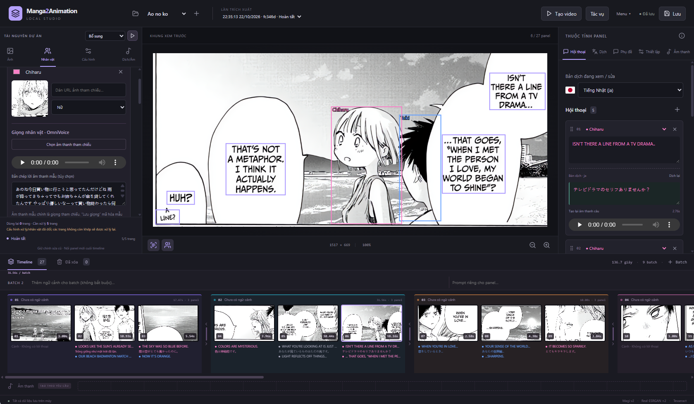
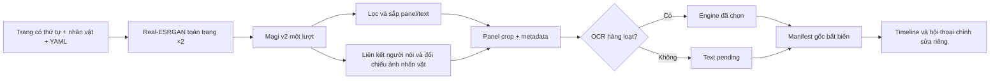

# Manga2Animation · Local Studio

Trình chuẩn bị dữ liệu và biên tập manga chạy trên máy: nâng cấp ảnh, tách panel,
nhận diện nhân vật/người nói, OCR và chỉnh sửa thành timeline có batch.
Đây là bước chuẩn bị cho tạo animation; hiện chưa gọi API tạo video hoặc tự sinh kịch bản.



## Điểm chính

- **Real-ESRGAN trên toàn trang, mặc định ×2 (chọn ×1–×4)**, sau đó Magi v2 phân tích panel, chữ và nhân vật trong một lượt.
- Tên nhân vật ổn định theo ảnh tham chiếu; vùng không nhận diện được giữ ID riêng và nhãn `unknown`.
- OCR hàng loạt tùy chọn: **Tesseract**, **Indra ONNX**, **Magi v2/v3**, **PaddleOCR PP-OCRv5**. V2 dùng lại model đã nạp.
- Timeline kéo thả, batch có màu, sửa lời thoại/người nói, thời lượng và prompt; ẩn/khôi phục panel.
- OCR lại riêng panel là **đề xuất**, chỉ áp dụng khi bạn chọn. Kết quả gốc được giữ nguyên.
- Mỗi Extract có UUID, snapshot và trạng thái riêng. Project lưu trên filesystem, không cần database.
- Mặc định **trích xuất bổ sung**: dùng lại trang còn hợp lệ, chỉ chạy model trên trang mới/thay đổi;
  giữ timeline/thoại/bản dịch/âm thanh đã review và nối panel mới vào cuối.
- Một hàng đợi GPU, có khóa giữa CLI/web để tránh chạy nhiều model cùng lúc.
- Bấm trang upload để sửa/vẽ panel và bubble, gán người nói rồi Extract áp dụng bố cục đó.
- Thoại/bản dịch theo màu nhân vật, cấu hình riêng giọng Unknown.
- MP4 trình chiếu theo timeline, chọn độ phân giải/FPS, âm thanh và phụ đề lời gốc/bản dịch; font, vị trí, căn lề và màu nhân vật tùy chỉnh.

## Setup và chạy nhanh

Hướng dẫn từng bước cho máy mới: **[docs/setup.md](docs/setup.md)**.
Chạy Python trên máy, không bắt buộc venv hoặc `pip install -e .`.

```powershell
# Sau khi có PyTorch phù hợp và Tesseract:
python -m pip install -r requirements.txt
python scripts/download_models.py
npm --prefix frontend ci
npm --prefix frontend run build
python scripts/check_setup.py
python run.py
```

## Chuẩn bị model và Tesseract

Tải các checkpoint từ nguồn chính thức và đặt đúng đường dẫn:

Tesseract là chương trình riêng với gói `pytesseract`. Cần bộ ngôn ngữ `vie` cho thoại Việt.
[Tài liệu cài Tesseract](https://tesseract-ocr.github.io/tessdoc/Installation.html).
Sửa `ocr.tesseract.command` trong YAML nếu máy khác có đường dẫn executable khác;
đặt `null` để dùng Tesseract trên PATH. `language: vie`, `psm: 6` dành cho chữ Việt ngang.

## Sử dụng trình biên tập

1. Tạo/chọn project; tải nhiều ảnh và kéo đổi thứ tự trang trong tab **Ảnh**.
2. Thêm nhân vật, tên, màu, giới tính tùy chọn và ảnh upload/URL trong tab **Nhân vật**.
3. Chọn hướng đọc và ngưỡng lọc trong **Cấu hình**. Tích OCR hàng loạt và chọn engine nếu muốn đọc chữ ngay.
4. Chọn lần Extract muốn kế thừa, chọn **Bổ sung/Chạy lại toàn bộ** ở góc trên cột trái rồi bấm nút chạy và xác nhận.
   Mặc định dùng **Bổ sung**; phần trạng thái cho biết số trang dùng lại/cần xử lý. Hủy xác nhận sẽ không tạo job.
   Muốn chạy lại mọi trang và tạo timeline mới, chọn **Trích xuất lại toàn bộ**.
5. Chọn panel trên timeline, bật bbox chữ/nhân vật, sửa thoại hoặc kéo đổi thứ tự lời thoại.
6. Kéo panel trong/giữa các batch. Kéo thanh ranh giới hoặc bấm mũi tên để chuyển panel cuối/đầu giữa hai batch.
7. Nút ẩn đưa panel sang **Đã xóa**; khôi phục không ảnh hưởng metadata gốc. Mặc định mỗi panel 4 giây.
8. Chỉnh ngữ cảnh batch/prompt panel. Tự lưu sau khoảng 0,9 giây; nút **Lưu** ghi ngay.
9. OCR riêng panel: chọn engine → chạy → xem đề xuất → **Áp dụng kết quả** hoặc bỏ qua.

## CLI và YAML

```powershell
python run.py extract --config configs/pipeline.yaml
```

Lệnh trên nhập ảnh/nhân vật tham chiếu theo YAML vào project mới rồi trích xuất.
Để bổ sung project có sẵn, dùng `--project <id>`; ảnh, nhân vật và cấu hình mặc định lấy từ project đó.
`--base-run <uuid>` chọn bản kết quả/chỉnh sửa được kế thừa; nếu bỏ trống dùng lần hoàn tất gần nhất.
`--full` buộc chạy lại tất cả. Nếu truyền `--config`, YAML đó sẽ ghi đè cấu hình project trước khi chạy.
Đường dẫn tương đối của model/input trong YAML tính từ thư mục gốc repository,
không phụ thuộc working directory khi gọi bằng đường dẫn tuyệt đối tới `run.py`.

[configs/pipeline.yaml](configs/pipeline.yaml) giữ ngưỡng, đường dẫn và ảnh tham chiếu trước đây.
Cấu hình được lưu bằng YAML. `output` cũ được giữ làm thông tin chuyển đổi;
kết quả mới luôn nằm dưới `projects/<project_id>/extracts/<uuid>/`.
`panel_detection_threshold` điều chỉnh ngưỡng phát hiện panel; giảm ngưỡng nếu bỏ sót khung.

```yaml
direction: jp          # jp: phải sang trái; vn: trái sang phải
min_panel_area: 0.05   # bỏ panel dưới 5% diện tích trang
nested_ratio: 0.25
text_overlap: 0.5
text_padding: 0.1      # mở rộng mỗi phía 10% kích thước vùng chữ
batch_size: 3
ocr:
  enabled: true        # false vẫn detect chữ/người nói nhưng chưa OCR
  engine: tesseract   # tesseract | indra | magi_v2 | magi_v3 | paddleocr
```

Đây là phần trích cấu hình; xem YAML đầy đủ để có `upscale`, `magi` và tùy chọn từng OCR.
Project có `config.yaml` riêng. Thay cấu hình không thay đổi các lần trích xuất trước đó.

## Luồng và cấu trúc



```text
configs/                 YAML dùng chung và global prompt
src/manga2animation/
  api.py                 API FastAPI, phục vụ frontend build
  cli.py                 Entry point web/extract
  settings.py            YAML và kiểm tra cấu hình
  storage.py             Project, snapshot, lưu nguyên tử và revision
  domain.py              Dữ liệu manifest và ngữ cảnh đọc artifact
  pipeline.py            Điểm import extract/load_panel_images
  services/
    projects.py          Nhập bộ ảnh/nhân vật theo cấu hình
    extraction.py        Điều phối pipeline và tạo manifest
    incremental.py       Kiểm tra trang hợp lệ, chụp lại cache và giữ chỉnh sửa
    models.py            Adapter nạp model local
    jobs.py              Hàng đợi extract/OCR và proposal
    gpu.py               Khóa GPU giữa thread/tiến trình
  enhancement/           Real-ESRGAN PyTorch
  layout/                Hình học, lọc và thứ tự đọc
  ocr/                   tesseract.py, indra.py, magi.py, paddle.py
  translation/           Provider Googletrans, dễ thêm provider khác
  audio/                 Adapter và worker OmniVoice tách runtime
frontend/                React/TypeScript, Vite và package-lock.json
tests/                   Unit/API bằng model giả + browser smoke
third_party/             Thông tin nguồn và giấy phép
projects/                Dữ liệu runtime, không đưa lên Git
```

## Dữ liệu kết quả

```text
projects/<project_id>/
  project.json                Tên, trang có thứ tự, global prompt, nhân vật
  config.yaml
  sources/  references/
  extracts/<uuid>/
    snapshot.json  config.yaml
    reuse.json               Kế hoạch và bản chụp kết quả/chỉnh sửa được dùng lại
    sources/  references/     Bản sao đầu vào độc lập
    upscaled/                Trang upscale theo tỉ lệ cấu hình (mặc định ×2)
    detections/              Kết quả Magi thô theo trang
    panels/                  Crop từ trang upscale
    manifest.json            Kết quả gốc, schema_version 1.0
    edits.json               Timeline/thoại/prompt/thời lượng/trạng thái ẩn
    status.json              queued/running/completed/failed/interrupted
    proposals/               Kết quả OCR lại, không ghi đè manifest
```

Đường dẫn artifact trong manifest tính tương đối thư mục Extract.
Bbox dạng `[x1, y1, x2, y2]`, pixel, gốc trên trái, cạnh phải/dưới loại trừ.
`bbox.original`, `bbox.upscaled`, `bbox.panel` ghi rõ ba hệ tọa độ;
`bbox_padded` lưu riêng vùng chữ đã nới. Text/nhân vật không gắn được giữ ở
`pages[].unassigned_texts` và `unassigned_characters`.
Unknown được gom theo cluster trong **từng trang**, không khẳng định danh tính xuyên trang.

**Khi thêm trang:** trang được dùng lại phải có cùng ID, nội dung ảnh, cấu hình detect/lọc/OCR,
ảnh tham chiếu nhân vật và thông tin model. Đổi global prompt, giọng, màu/tên nhân vật,
dịch hoặc tốc độ đọc không làm chạy lại detect/OCR. Đổi hướng đọc/ngưỡng/OCR/ảnh tham chiếu
có thể buộc xử lý lại; UI hiện số trang và thông báo trước khi chạy.
Nếu không có trang mới/thay đổi, pipeline không nạp model.
Timeline/batch đã chỉnh được giữ; panel mới nối cuối theo thứ tự trang mới.
Artifact đã dùng lại, kể cả WAV, được sao chép vào lần mới nên có thể xóa lần cũ mà lần mới vẫn mở được.
Thư mục Extract cũ không bị sửa; bản chỉnh sửa được chụp tại thời điểm bấm bắt đầu.

Trong Python hoặc notebook:

```python
from manga2animation.pipeline import load_panel_images

items = load_panel_images("projects/<id>/extracts/<uuid>/manifest.json")
display(items[0]["image"])
# Crop lại, không ghi đè ảnh đã lưu:
items = load_panel_images("projects/<id>/extracts/<uuid>/manifest.json", split_panel=True)
```

## Kiểm thử

```powershell
$env:PYTHONPATH = "src"
python -m unittest discover -s tests -v
python -m pip install -r requirements-dev.txt
python -m playwright install chromium
python tests/ui_smoke.py
```

Browser smoke tự mở backend riêng ở cổng 8001, dùng thư mục tạm và model giả.
Không cần chạy server chính để kiểm thử. Unit test kiểm tra thứ tự Nhật/Việt,
tọa độ/crop, chỉ upscale một lần, chọn/tắt OCR, snapshot độc lập, lỗi và lưu chỉnh sửa.
Browser test kiểm tra upload, nhân vật, extract, kéo thả, sửa/ẩn/khôi phục, OCR đề xuất và mở lại.
Browser smoke còn kiểm tra dịch, clone/preview/TTS với provider giả,
tính lại thời lượng khi đổi tốc độ, dừng Extract và xóa vào thùng rác.
Kiểm thử bổ sung xác nhận thêm trang chỉ gọi model trên trang mới, không nạp model nếu mọi trang đều dùng lại,
giữ chỉnh sửa/timeline/âm thanh, phát hiện thay đổi cấu hình/ảnh và mở lần mới sau khi xóa baseline.
Các kiểm thử bổ sung kiểm tra nhiều bản dịch theo ngôn ngữ, chọn bản dịch để sinh giọng,
giữ thứ tự vùng cắt thủ công, chỉnh clip không sửa WAV gốc, danh sách tác vụ,
kéo thanh chia cột, zoom trang và popup thông tin.

## Giới hạn

Panel chéo/lồng có chủ ý, hội thoại không có đuôi bubble hoặc nhân vật ngoài khung có thể gán sai.
Magi OCR không được coi là phương án tối ưu cho tiếng Việt; nên so sánh các engine trên crop thực tế.
Xử lý lần lượt giảm áp lực VRAM nhưng không đảm bảo mọi trang/engine đều vừa bộ nhớ;
có thể giảm tile hoặc chuyển thiết bị sang CPU. Tất cả trang hiện được giữ trong RAM khi đối chiếu nhân vật.
Dừng Extract giữ artifact/trạng thái để kiểm tra và dừng giữa các lượt model; không ép ngắt kernel đang infer.
Chưa tự resume. TTS worker có thể dừng riêng; Extract không tự gọi dịch hoặc TTS.
Ứng dụng dành cho một người dùng local, không có đăng nhập/phân quyền cho triển khai công khai.
