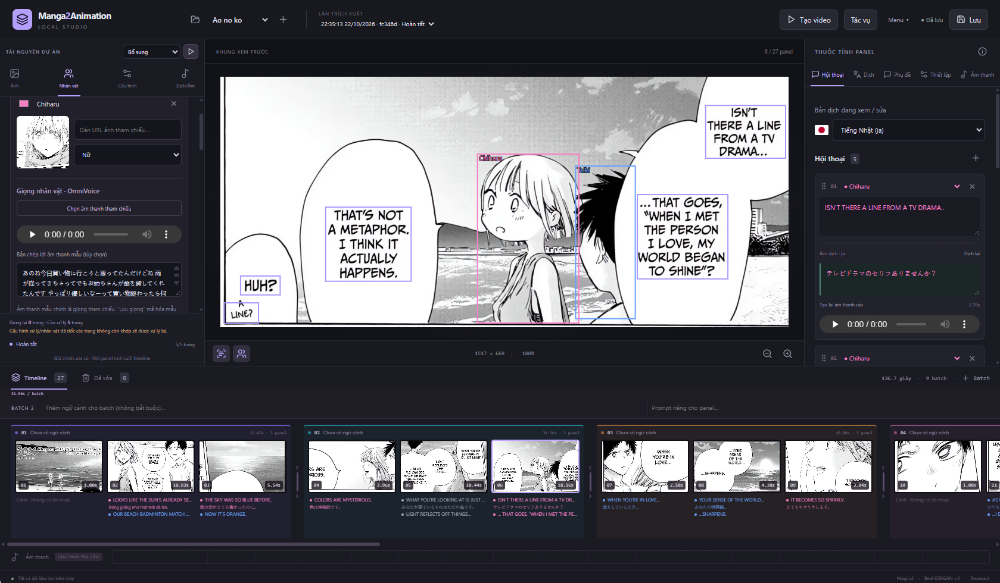

# Manga2Animation

Công cụ chuyển trang truyện thành video trình chiếu có hội thoại, âm thanh và phụ đề.
Giao diện biên tập giúp kiểm soát từng bước, từ nhận diện panel đến sắp xếp timeline và xuất video.



## Tính năng

- **Phân tích trang truyện:** upscale bằng Real-ESRGAN, tách panel, nhận diện nhân vật và liên kết người nói bằng Magi v2; hỗ trợ thứ tự đọc Nhật/Việt.
- **OCR nhiều engine:** Tesseract, PaddleOCR, Indra và Magi; chạy hàng loạt hoặc đọc lại từng panel.
- **Biên tập trực quan:** chỉnh vùng cắt, bubble, hội thoại, người nói, batch và thời lượng; kéo thả để sắp xếp timeline.
- **Dịch đa ngôn ngữ:** Googletrans, Ollama hoặc API tương thích OpenAI; lưu và chỉnh sửa nhiều bản dịch.
- **Giọng nói nhân vật:** clone giọng bằng OmniVoice, tạo âm thanh từ lời thoại gốc hoặc bản dịch.
- **Xuất video MP4:** tùy chỉnh độ phân giải, FPS, âm thanh và phụ đề theo màu nhân vật.
- **Quản lý project:** tự lưu chỉnh sửa, theo dõi tác vụ và bổ sung trang mà không xử lý lại các trang còn hợp lệ.

## Video demo

[▶ Xem video kết quả](project_example/output/video/slideshow.mp4)

## Bắt đầu

Cần Python 3.12, Node.js 22, PyTorch phù hợp phần cứng, Tesseract và FFmpeg.
Xem [hướng dẫn cài đặt](docs/setup.md) để chuẩn bị thư viện và model, bao gồm runtime OmniVoice tùy chọn.

```bash
python -m pip install -r requirements.txt
python scripts/download_models.py
npm --prefix frontend ci
npm --prefix frontend run build
python run.py
```

Mở **http://127.0.0.1:8000**. Các lần chạy tiếp theo chỉ cần `python run.py`.

Tạo project → tải trang truyện và ảnh nhân vật → trích xuất → chỉnh sửa, dịch và tạo giọng → xuất video.

## Cấu hình và tài liệu

Cấu hình xử lý dùng YAML tại [`configs/pipeline.yaml`](configs/pipeline.yaml).
Mỗi project lưu riêng ảnh nguồn, các lần trích xuất và nội dung biên tập trong `projects/`.

- [Cài đặt và chạy](docs/setup.md)
- [Sử dụng trình biên tập](docs/editor.md)
- [Thiết lập âm thanh](docs/audio.md)
- [Kiến trúc pipeline](docs/architecture.md)
- [Nguồn và giấy phép bên thứ ba](third_party/README.md)

Ứng dụng sử dụng FastAPI và React/TypeScript. Chất lượng OCR, nhận diện người nói và giọng nói
phụ thuộc model và dữ liệu đầu vào; kết quả có thể chỉnh sửa trước khi xuất.
